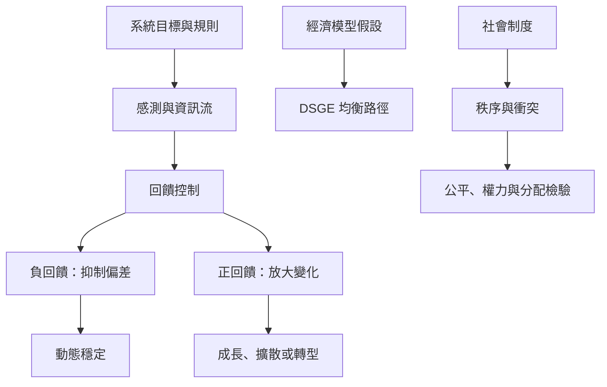

本圖譜比較工程控制、宏觀經濟模型與社會理論中的均衡語言。控制系統以回饋修正偏差；DSGE 模型在特定假設下推導經濟動態；結構功能論以秩序維持解釋制度調整。三者的數學、證據與規範含義不同，不能因都使用「均衡」一詞就視為相同理論。

## 概念
* [[回饋]]
* [[負回饋]]
* [[正回饋]]
* [[穩定性]]
* [[動態隨機一般均衡]]
* [[社會均衡]]
* [[穩態經濟]]
* [[系統邊界]]
* [[回饋延遲]]
* [[資訊流]]
* [[系統思考]]
* [[知識管理]]
* [[預防性維護]]

## 永久筆記
* [[負回饋能抑制偏差但不保證系統永遠穩定]]
* [[正回饋能放大變化也可能使系統跨越臨界點]]
* [[經濟模型中的均衡是條件推導而不是價值判決]]
* [[社會秩序的持續不等於社會關係公平]]
* [[永續性需要同時考慮經濟規模與物質吞吐量]]
* [[動態平衡是描述性概念不能直接當成生活規範]]

## 靈感筆記
* [[為日常制度設計低成本而及時的回饋迴路]]
* [[在團隊中把緊急修補轉化為持續維護制度]]
* [[用平衡稽核表檢查制度是否把成本推給他人]]

## 全書
* [[Dynamic_equilibrium]]

## 核心文獻
* [[回饋控制以感測資訊修正系統偏差]]
* [[央行使用動態隨機一般均衡模型研究總體經濟衝擊]]
* [[法國央行2026年研究指出DSGE模型價值在於連結理論資料與政策實驗]]
* [[結構功能論以動態均衡解釋制度如何回應社會壓力]]
* [[生態經濟學的穩態經濟關注人口資本存量與物質通量]]
* [[梅多斯的槓桿點提醒系統改變不只在調整參數]]
