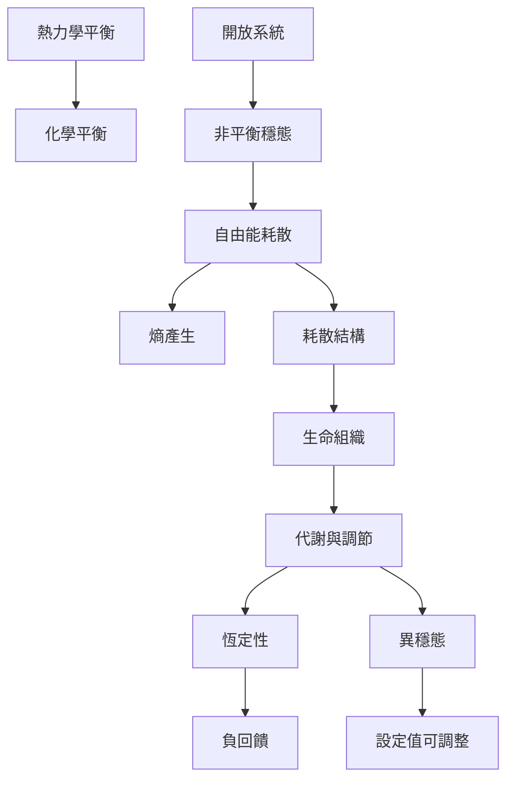

本圖譜從化學與熱力學延伸到生命：化學平衡是可逆反應的速率平衡；生命則通常是開放的非平衡系統，靠自由能耗散與代謝通量維持組織。生理恆定性與異穩態再把問題帶到多層調節、預測與設定值變動。

## 概念
* [[化學平衡]]
* [[熱力學平衡]]
* [[非平衡熱力學]]
* [[非平衡穩態]]
* [[耗散結構]]
* [[熵產生]]
* [[恆定性]]
* [[異穩態]]
* [[調定點]]
* [[負回饋]]
* [[物質通量]]

## 永久筆記
* [[生命的有序結構依賴能量流而非封閉靜止]]
* [[設定點可能隨預期與情境而改變]]
* [[零淨通量與非零通量穩態不能混為一談]]

## 靈感筆記
* [[把個人狀態紀錄從追求固定數值改成觀察調節範圍]]
* [[把平靜理解為能與波動共處而不是消除波動]]

## 全書
* [[Dynamic_equilibrium]]

## 核心文獻
* [[普里高津的研究顯示遠離平衡也能形成有序結構]]
* [[生化網絡的功能表現受到能量耗散與速度準確度權衡約束]]
* [[生理學重新檢視恆定性如何在時間中維持生命組織]]
* [[異穩態以改變調節方式回應環境挑戰]]
* [[生理穩定包含恆定異穩態與調定點重設等多層機制]]
* [[日本神經生理學綜述把異穩態視為預測性自律調節]]
