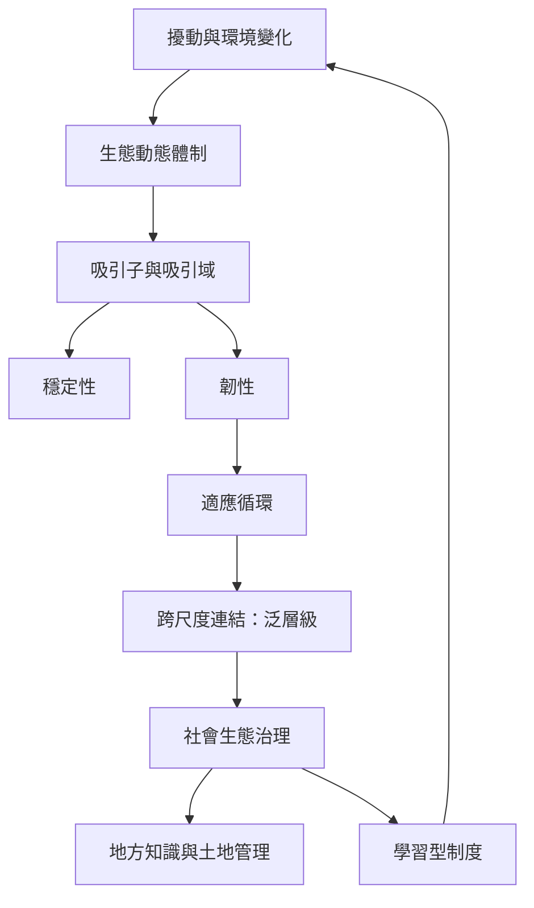

本圖譜把生態系統的動態體制、韌性、吸引域、適應循環與泛層級放在同一張圖中，並加入原住民族土地管理與適應性制度。重點是生態系統並非總圍繞單一歷史基準線波動；人類治理也可能參與塑造動態，而不是站在自然之外。

## 概念
* [[韌性]]
* [[吸引子]]
* [[吸引域]]
* [[適應循環]]
* [[泛層級]]
* [[動態體制]]
* [[系統邊界]]
* [[社會均衡]]
* [[擾動制度]]
* [[適應性治理]]
* [[人類世]]
* [[社會生態系統]]
* [[適應性管理]]
* [[城市生態學]]
* [[照顧工作]]
* [[公平]]
* [[權力]]

## 永久筆記
* [[穩定性與韌性回答的是不同問題]]
* [[自然生態系統未必圍繞單一歷史基準波動]]
* [[人類土地管理可以是生態動態的一部分]]
* [[適應性制度的穩定來自持續學習而非僵化]]
* [[社會秩序的持續不等於社會關係公平]]
* [[地方知識能否成為回饋取決於社群是否擁有共同決策權]]

## 靈感筆記
* [[把生態保育目標從固定景觀轉為可持續功能]]
* [[從步行路線觀察城市環境如何在日常擾動中維持功能]]
* [[在社群聚會中用共享資源與回饋形成自我調節]]

## 全書
* [[Dynamic_equilibrium]]

## 核心文獻
* [[Holling區分工程韌性與生態韌性]]
* [[生態動態體制比單一靜態基準更能描述複雜生態變化]]
* [[全球草原研究顯示非平衡假說只在特定條件下獲得支持]]
* [[塔斯馬尼亞景觀研究顯示原住民族長期主動塑造生態環境]]
* [[兩萬兩千年沉積記錄呈現Palawa火管理如何維持開放地景]]
* [[訪談研究顯示文化燃燒復興也取決於原住民族的決策權]]
* [[Yugul Mangi巡護員以季節知識共創適應性草原燃燒日曆]]
* [[社會生態治理需要能學習並調整的制度]]
* [[泛層級理論描述人類與自然系統跨尺度的適應循環]]
