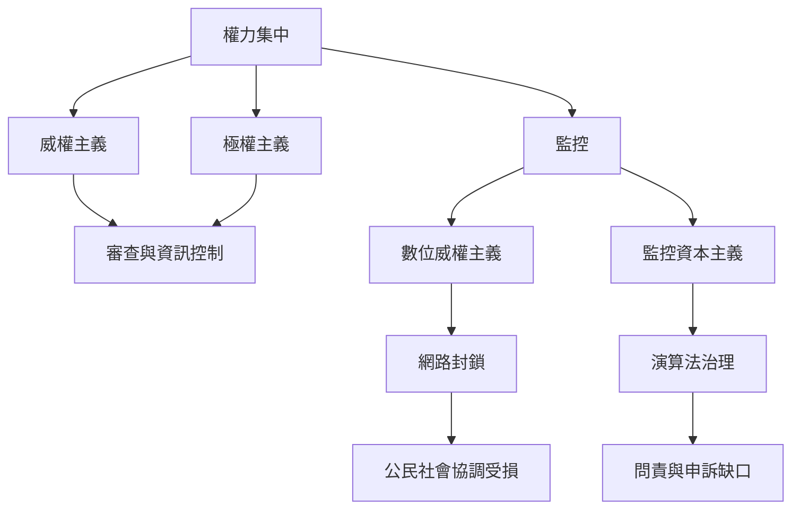

反烏托邦中的權力可由國家統治、企業平台、監控技術與基礎設施共同構成。這張圖聚焦權力的來源、運作機制與問責缺口。

## 思與行
* 研究現實案例時，把國家權力與企業權力分別標示，再分析它們的合作與制衡。
* 將每一種治理工具連到透明度、申訴、獨立監督與退出權等問責條件。

## 參考
* [[監控治理把可見性轉化為不對稱的權力]]
* [[企業與國家可能共同形成難以問責的治理基礎設施]]
* [[資訊封鎖破壞公民社會協調與受害者求助能力]]
* [[極權主義]]、[[威權主義]]、[[監控]]、[[數位威權主義]]、[[監控資本主義]]
