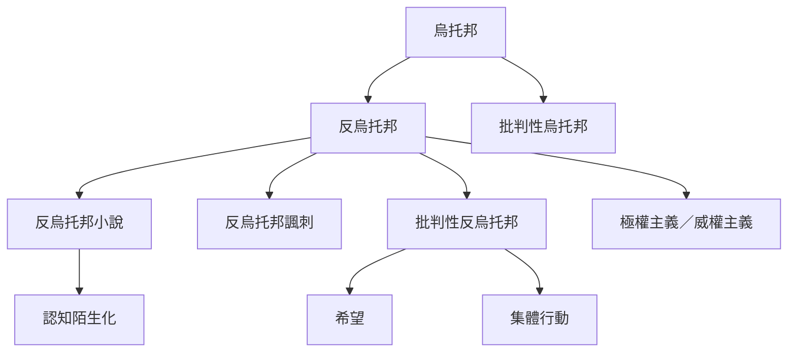

本概念地圖整理反烏托邦的類型、歷史脈絡與敘事功能。閱讀時可先分辨一般反烏托邦、反烏托邦諷刺與批判性反烏托邦，再進入認知陌生化、希望與文化商品化等議題。

## 思與行
* 用這張圖整理小說、電影、遊戲與政治論述，避免把所有黑暗未來都歸為同一類型。
* 補充作品時，註明它對應的歷史焦慮與是否保留反抗空間。

## 參考
* [[反烏托邦同時是文學類型也是理解暴政與社會崩潰的工具]]
* [[批判性反烏托邦在黑暗敘事中保留可行的希望]]
* [[反烏托邦不是烏托邦的簡單反面]]
* [[反烏托邦]]、[[烏托邦]]、[[反烏托邦小說]]、[[批判性反烏托邦]]、[[認知陌生化]]
