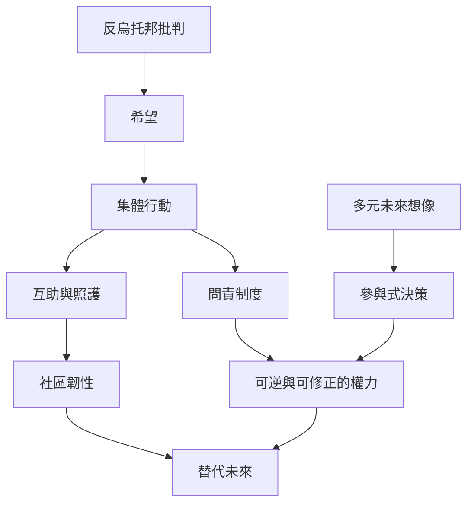

反烏托邦研究若只描繪壓迫，很容易落入無路可走的悲觀。此圖將希望視為集體能力，並連結多元未來想像、互助、公共問責與制度修正。

## 思與行
* 為「更好的未來」列出制度條件，而不只列出價值口號；尤其檢查照護工作是否公平分配。
* 以社區尺度實驗互助與公共決策，再透過反思修正流程。

## 參考
* [[希望是組織能力而不只是安慰性的情緒]]
* [[個人反抗需要連接集體制度改革才可能持久]]
* [[以關懷與互賴建構非反烏托邦的未來]]
* [[希望]]、[[集體行動]]、[[烏托邦]]
