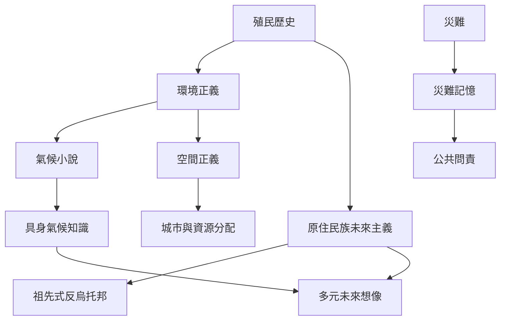

氣候反烏托邦不只是自然災害故事，也關於殖民歷史、環境負擔、知識權力與土地關係。這張圖連結原住民族未來主義、非洲氣候小說、南非城市敘事與福島災難記憶。

## 思與行
* 研究氣候敘事時，把地區、殖民歷史與不同群體的危機時間感放在分析中心。
* 將文學、地方知識與科學報告並置，尊重資料類型之間的差異。

## 參考
* [[原住民族氣候敘事指出殖民暴力早已使部分群體身處反烏托邦]]
* [[非洲氣候小說以具身知識修正主流氣候想像]]
* [[日本福島後文學以多重聲音抵抗單一官方敘事]]
* [[南非後種族隔離小說顯示公共空間仍可能持續排除]]
* [[氣候小說]]、[[環境正義]]、[[原住民族未來主義]]、[[空間正義]]
