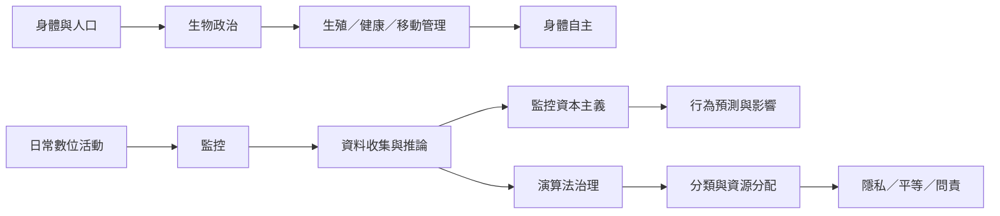

反烏托邦治理不只控制思想與資訊，也透過身體、生殖、健康、身分與行為資料管理人口。這張圖將生物政治、監控資本主義與數位身分風險放在一起理解。

## 思與行
* 閱讀身體政治作品時，留意身體如何被分類、管理與動員，也留意人物如何重建自主。
* 在數位政策分析中，把資料流程與實際服務結果連結，特別注意資料錯誤造成的排除。

## 參考
* [[使女的故事展示生殖控制如何建構極權政治]]
* [[監控資本主義把日常經驗轉化為行為預測商品]]
* [[印度與其他地區的數位身分系統需要以排除風險作為評估起點]]
* [[生物政治]]、[[監控資本主義]]、[[監控]]
