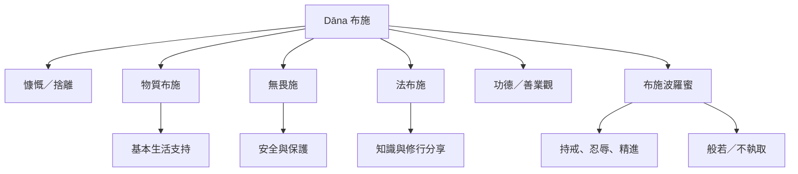

此圖整理佛教Dāna由基本布施行為延伸至心性訓練、三類布施、功德與波羅蜜的關係。經典、注疏與大乘詮釋不是同一層次，閱讀時須注意文本時代與傳統差異。

## 相關概念
* [[Dāna（布施）]]、[[Dāna-pāramitā（布施波羅蜜）]]、[[物質布施（Āmisa-dāna）]]、[[無畏施（Abhaya-dāna）]]、[[法布施（Dhamma-dāna）]]
* [[慷慨（Generosity）]]、[[功德（Puñña／Puṇya）]]、[[功德田（Puñña-khetta）]]、[[僧伽（Saṅgha）]]、[[托缽（Alms Round）]]、[[cāga（捨與慷慨）]]

## 核心筆記
* [[布施是一種修心實踐而不只是財物轉移]]
* [[三種布施讓物質支持安全感與知識分享彼此補足]]
* [[布施的價值需要同時考量動機、處境與後果]]
* [[大乘布施波羅蜜把給予帶向不執取與菩薩行]]

## 延伸概念
* [[無畏施把安全感視為可以分享的資源]]
* [[般若（Prajñā）]]
* [[忍辱（Kṣānti）]]
* [[正念（Mindfulness）]]
