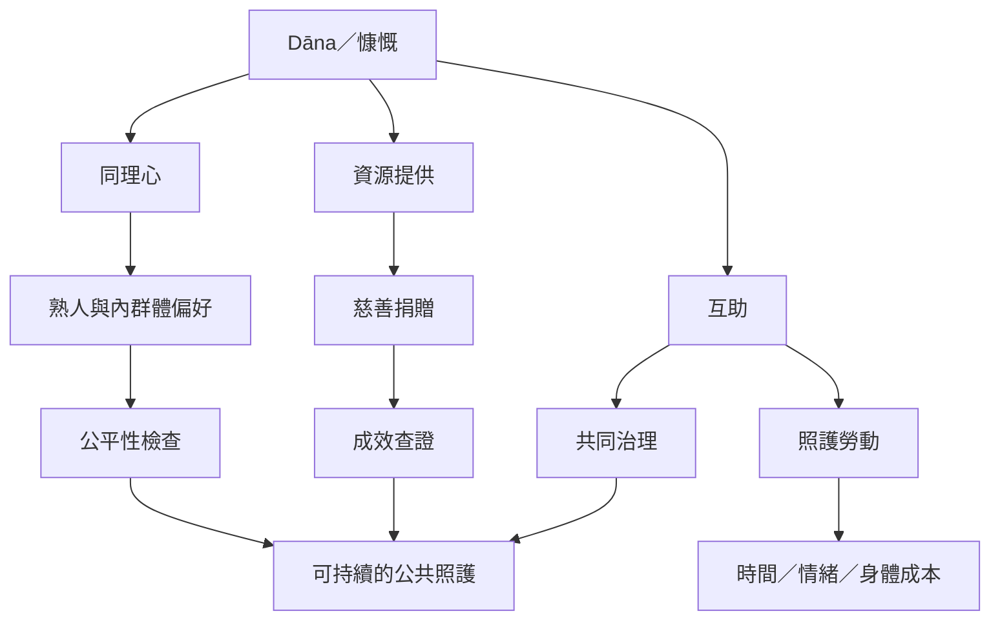

此圖將傳統布施的倫理問題連接到現代慈善心理學、有效利他、互助與照護經濟。核心是同時看見善意、證據、權力與照護成本。

## 相關概念
* [[慈善捐贈（Charitable Giving）]]、[[有效利他主義（Effective Altruism）]]、[[同理心（Empathy）]]、[[照護經濟（Care Economy）]]
* [[互助（Mutual Aid）]]、[[共食（Commensality）]]、[[公共財（Public Good）]]、[[知識共享（Knowledge Sharing）]]

## 核心筆記
* [[互助與布施可以互補但不應混為一談]]
* [[慷慨需要同理心也需要對實際效果保持查證]]
* [[給予的範圍需要超越熟人與內群體偏好]]
* [[慷慨不應以耗損自己或傷害他人為代價]]

## 延伸概念
* [[利他主義（Altruism）]]
* [[正念（Mindfulness）]]
