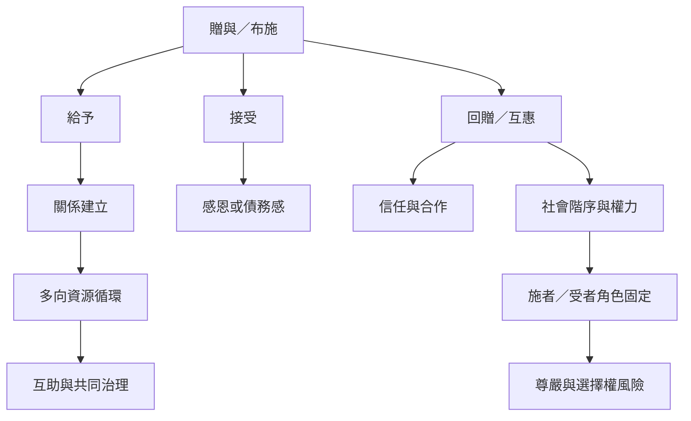

此圖從人類學贈與理論出發，呈現布施與互惠、身分、債務、尊嚴及資源循環的關係。贈與不只是善意，也可能帶來社會義務與權力差異。

## 相關概念
* [[贈與經濟（Gift Economy）]]、[[互惠（Reciprocity）]]、[[互助（Mutual Aid）]]、[[Dāna（布施）]]、[[慈善捐贈（Charitable Giving）]]
* [[功德田（Puñña-khetta）]]、[[社會認同（Social Identification）]]（由社會認同研究筆記連結）

## 核心筆記
* [[禮物交換會建立關係也可能帶來回贈義務]]
* [[布施制度既能建立互賴也可能重製身分差異]]
* [[布施應讓接受者保有尊嚴與選擇權]]
* [[布施關係可以由單向施予轉成多向資源循環]]

## 延伸概念
* [[布施的意義是在具體關係中共同形成的]]
* [[受贈者不是被動容器而是共同關係的參與者]]
* [[社會認同（Social Identification）]]
