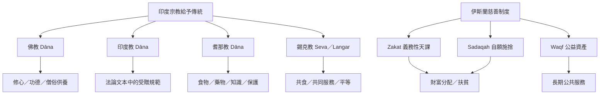

此圖將印度宗教Dāna及其他宗教的給予實踐放在同一比較視野，但保留其制度差異。相似之處可用來提出問題，不應把不同宗教術語互相取代。

## 相關概念
* [[Dāna（布施）]]、[[Dāna-pāramitā（布施波羅蜜）]]、[[Aparigraha（不執取／不佔有）]]、[[Karuṇā（慈悲）]]
* [[Sevā（無私服務）]]、[[Langar（錫克教共食廚房）]]、[[Zakat（天課）]]、[[Sadaqah（自願施捨）]]、[[Waqf（宗教公益信託）]]

## 核心筆記
* [[跨宗教比較必須保留各自的制度與歷史差異]]
* [[三種布施讓物質支持安全感與知識分享彼此補足]]
* [[共食能把慈善從發放物資轉成平等的共同生活]]

## 延伸概念
* [[耆那教（Jainism）]]
* [[不害（Ahimsa）]]
* [[回向（Merit Transfer）]]
