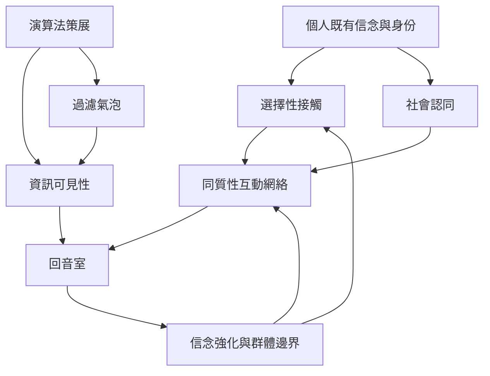

回音室由心理選擇、社會關係與平台機制交互生成。核心概念包括 [[回音室 Echo chamber]]、[[過濾氣泡 Filter bubble]]、[[選擇性接觸 Selective exposure]]、[[同質性 Homophily]]、[[確認偏誤 Confirmation bias]]、[[社會認同 Social identity]] 與 [[演算法策展 Algorithmic curation]]。

可由心理機制向外閱讀平台設計與網絡結構，再回到 [[回音室是由選擇、關係與傳播結構共同形成的資訊環境]]。相關實證見 [[平台之間的互動設計會改變回音室的形成方式]]、[[使用者的選擇可能比動態消息排序更限制跨立場曝光]]。

* 本概念地圖連回 [[Echo_chamber]]。
