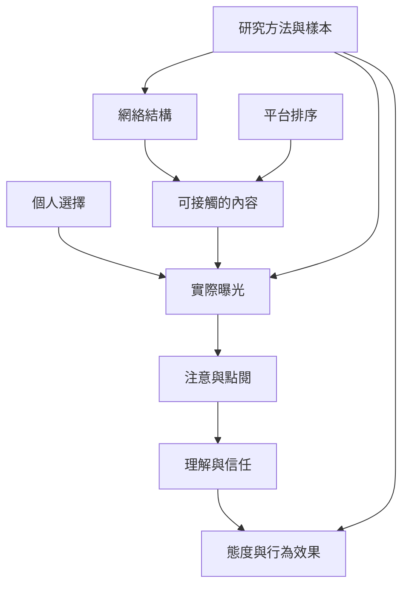

回音室研究需要區分網絡、曝光、注意、理解、信任與態度效果。核心概念包括 [[同質性 Homophily]]（可透過 [[同質性 Homophily]] 理解）、[[跨立場曝光 Cross-cutting exposure]]、[[資訊多樣性 Information diversity]]、[[政治極化 Political polarization]] 與 [[情感極化 Affective polarization]]。

此圖的核心提醒是：每一層都不能直接替代下一層。可搭配 [[回音室的測量必須區分網絡同質性與資訊接觸]]、[[資訊曝光、實際接觸與態度效果是不同研究層次]] 與 [[增加異議曝光不等於降低情感極化]] 閱讀。

* 本概念地圖連回 [[Echo_chamber]]。
