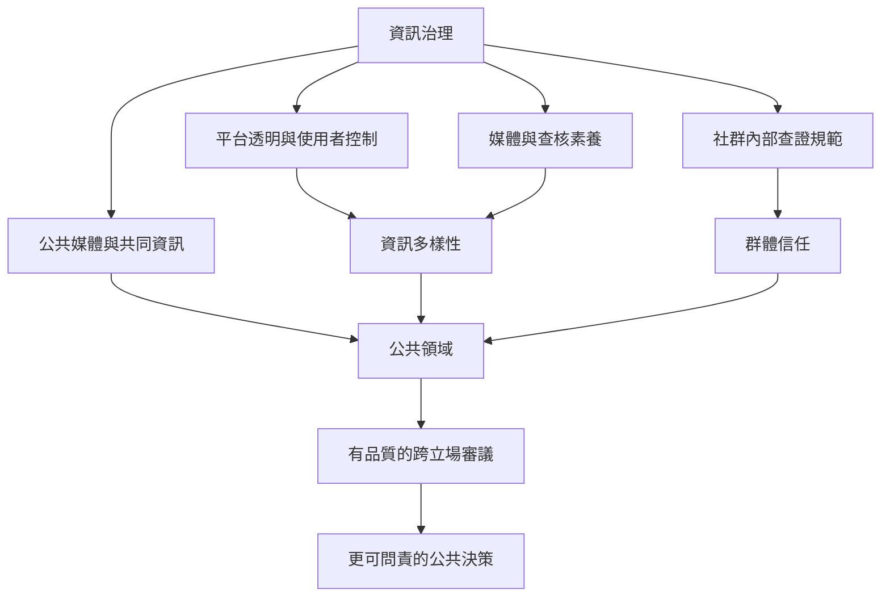

治理回音室不應以強迫接觸或全面監控為唯一解方，而應兼顧資訊多樣性、隱私、群體信任、公共領域與可持續的跨群交流。核心概念包括 [[事實查核 Fact-checking]]、[[錯誤資訊 Misinformation]]、[[虛假資訊 Disinformation]]、[[公共領域 Public sphere]] 與 [[審議民主 Deliberative democracy]]。

實踐方向可參照 [[每週檢視自己的資訊來源比追求抽象的資訊中立更可行]]、[[轉傳前停一下可以讓查核成為群體習慣]]、[[建立跨群體閱讀會可以把異議接觸轉化為持續關係]]。

* 本概念地圖連回 [[Echo_chamber]]。
