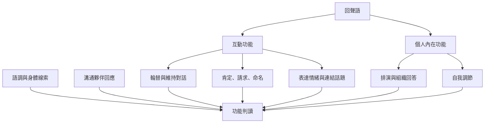

這張地圖以回聲語「正在做什麼」為核心，整理對話輪替、肯定、請求、命名、情緒表達、排演與自我調節等可能作用。功能不是固定附著在某種語句形式上，而是由語句、身體、情境和溝通夥伴共同構成。

相關永久筆記：[[回聲語的意義必須由互動脈絡而非重複形式推斷]]、[[回聲語可以支援輪替、肯定、請求與自我調節]]、[[回聲語的韻律與音樂性可能比字面內容更突出]]、[[溝通夥伴的回應會共同塑造回聲語的用途]]。

## 思與行
* 每次提出功能假設，都要附上支持線索和可能的替代解釋。
* 將溝通夥伴的調整納入觀察，不只評估說話者本身。

## 參考
* [[自然情境研究顯示即時回聲語可以承擔多種互動功能]]、[[以色列自閉症成人訪談指出回聲語可能具有自我調節與音樂性]]、[[中國會話分析顯示即時回聲語能組織對話行動]]。

書庫索引：[[Echolalia]]

