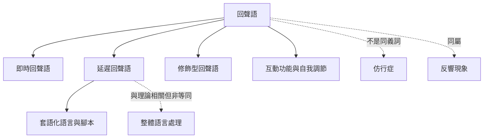

這張地圖整理回聲語的定義、時間型態、修飾形式及相關現象。分類用來描述觀察，不是替個體排定發展等級，也不能單獨推斷溝通意圖。

相關永久筆記：[[即時與延遲只描述時間差不能直接判定功能]]、[[延遲回聲語可能把舊語句帶入新的情境]]、[[回聲語的定義與測量尚未形成穩定共識]]、[[回聲語是一種跨診斷現象而非單一診斷]]。

## 思與行
* 描述一段語句時，分別記錄時間、修改幅度、素材來源和情境功能。
* 避免將 GLP、NLA 與延遲回聲語直接視為同義詞。

## 參考
* [[自然情境研究顯示即時回聲語可以承擔多種互動功能]]、[[跨診斷回顧指出回聲現象不應只放在自閉症框架理解]]、[[自然語言習得的階段模型仍缺乏充分實證支持]]。

書庫索引：[[Echolalia]]

