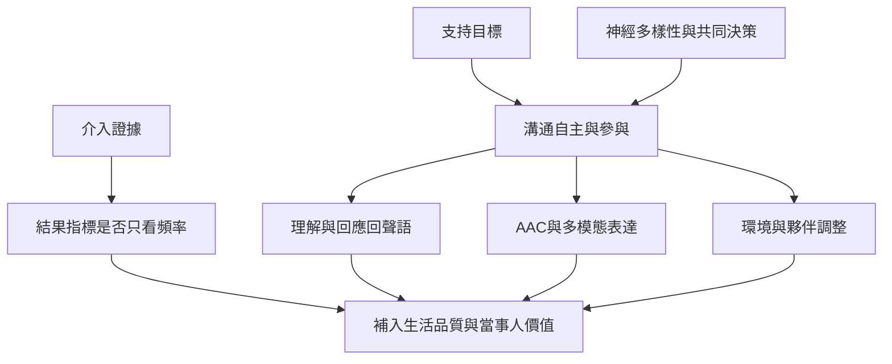

支持回聲語使用者時，關鍵問題不是如何讓語句消失，而是如何增加理解、選擇、表達與參與。現有回聲語介入研究常以減少頻率為目標，且品質與代表性有限；自閉症者自述、家庭經驗和教育現場觀察則提醒支持需尊重個別價值。AAC、溝通夥伴訓練和友善環境可以擴展溝通選項。

相關永久筆記：[[減少回聲語不等於增加溝通能力]]、[[介入成效應以溝通自主與參與衡量]]、[[AAC 可以擴充溝通管道而不是取代回聲語]]、[[研究必須納入當事人的價值與生活品質]]。

## 思與行
* 每個介入計畫都要說明它如何擴大溝通權，而非只說如何降低某項特徵。
* 把當事人與家人的偏好納入結果評估，並公開研究代表性限制。

## 參考
* [[回聲語介入系統性回顧發現研究品質不足以支持消除策略]]、[[介入技術範疇回顧顯示研究多衡量回聲語下降而非溝通增益]]、[[專業指引將AAC與個別化溝通目標納入自閉症支持]]。

書庫索引：[[Echolalia]]

