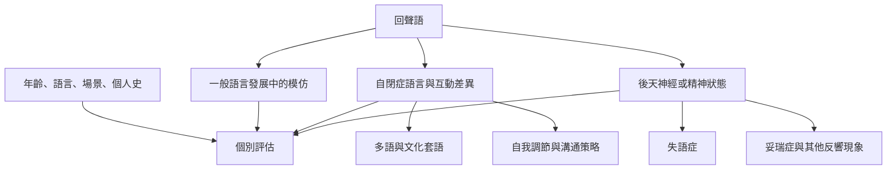

回聲語涉及發展、語言環境與臨床狀態等不同層次。幼兒會透過模仿學習語言；自閉症者可能長期以不同形式使用回聲語；失語症、妥瑞症、失智症或其他神經狀態也可能出現回聲現象。跨診斷比較應保留病因差異，而多語和文化環境則要求研究者注意語句來源與語用慣例。

相關永久筆記：[[回聲語是一種跨診斷現象而非單一診斷]]、[[文化套語與家庭語言環境會影響回聲語的形式]]、[[幼兒重複語言需要發展脈絡而非過早貼標籤]]。

## 思與行
* 在個案資料中將發展史、語言使用、病史和生活情境分開記錄。
* 尊重家庭語言，不把社會主流語言熟練度當成唯一語言能力指標。

## 參考
* [[跨診斷回顧指出回聲現象不應只放在自閉症框架理解]]、[[中文語料研究顯示固定語句可用於命名、描述與展開話題]]、[[早期臨床綜述指出回聲現象涉及多種神經與精神狀態]]。

書庫索引：[[Echolalia]]

