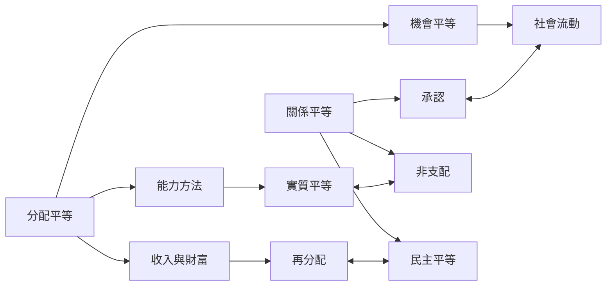

此地圖把分配理論常問的「平等什麼」拆成資源、福利、機會與能力，並與關係平等關注的支配、污名及平等參與連接。它可用來檢視政策是否只改善物質指標，卻沒有改變人們之間的權力關係。

## 概念關係圖

## 導覽脈絡
[[再分配]]、[[分配平等]]、[[實質平等]]、[[承認]]、[[平等必須回答究竟要讓什麼變得平等]]、[[機會平等]]、[[民主平等]]、[[任何平等主張都必須回答究竟要讓什麼變得平等]]、[[差異化支持有時才是實質平等]]、[[社會流動]]、[[能力方法]]、[[關係平等]]、[[非支配]]
