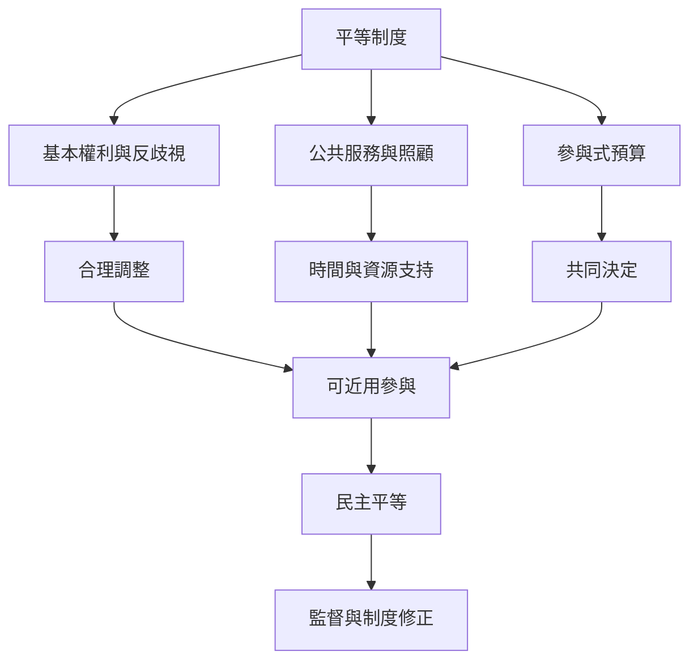

制度實踐地圖從基本權利與合理調整出發，連接福利分配、照顧服務、社區參與與公共預算。制度是否平等，不只看有沒有政策，也要看資源、權限、資訊與問責是否真正到達受影響者。

## 概念關係圖

## 導覽脈絡
[[代表權]]、[[參與式預算]]、[[實質平等]]、[[民主平等]]、[[參與式預算把平等從資源份額延伸至決策權]]、[[平等制度應容納分歧並能被受影響者修正]]、[[照顧經濟]]、[[身心障礙正義]]
