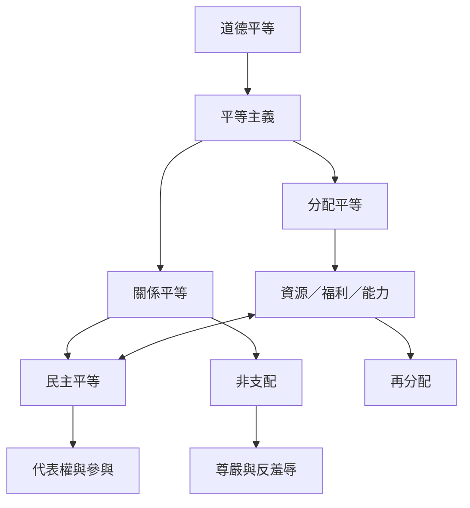

平等主義的分配路徑追問資源、福利、機會與能力如何分配；關係路徑則追問人們是否能免於支配、羞辱與階序。民主平等把共同決策與平等公民地位納入關係分析。兩條路徑可以互相補足：資源差距可能製造支配，而平等關係也需要物質保障。

## 概念關係圖

## 導覽脈絡
[[Egalitarianism]]、[[代表權]]、[[再分配]]、[[分配平等]]、[[平等]]、[[平等主義不只追求分配也關乎人們如何彼此相待]]、[[民主平等]]、[[任何平等主張都必須回答究竟要讓什麼變得平等]]、[[平等首先是彼此以平等者身分相待而非把結果磨成相同]]、[[道德平等]]、[[關係平等]]、[[非支配]]
