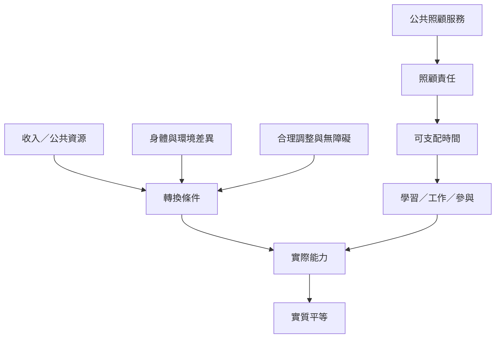

資源只是生活自由的投入條件。個人與環境的轉換條件、可近用性與照顧責任，會決定資源能否化為實際能力。性別化的無酬照顧也會改變人們可支配的時間，因而影響教育、收入與政治參與。

## 概念關係圖

## 導覽脈絡
[[實質平等]]、[[性別平等]]、[[照顧時間的分配是社會平等的基礎設施]]、[[能力平等衡量人們實際能成為與做到什麼]]、[[照顧經濟]]、[[社會再生產]]、[[能力方法]]、[[身心障礙正義]]
