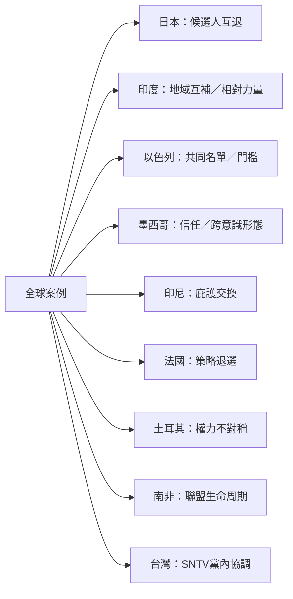

跨國案例展示選舉聯盟不是單一模式。日本呈現跨選區互惠與長期互賴；印度呈現區域支持互補與相對力量變化；以色列呈現選舉門檻促成共同名單；墨西哥呈現跨意識形態合作與互信；印尼呈現客戶主義與即時回報；法國呈現臨時性候選人退選；土耳其與撒哈拉以南非洲則提醒研究者注意反對派聯盟的組織能力與政體差異。

主要連結：[[日本自民黨與公明黨以互相讓出選區維持長期選舉合作]]、[[印度的全國性聯盟可以透過地域支持互補建立合作]]、[[印度選舉聯盟會因盟友相對支持度改變而瓦解]]、[[以色列共同名單回應選舉門檻但仍面臨內部分歧]]、[[墨西哥跨意識形態聯盟能否成立也取決於政黨互信]]、[[印尼地方選舉聯盟顯示庇護交換可能比意識形態更直接]]、[[法國2024年策略性退選顯示候選人協調受到多重動機影響]]。

概念入口：[[Electoral geography]]、[[Joint list]]、[[Clientelism]]、[[Candidate withdrawal]]。
