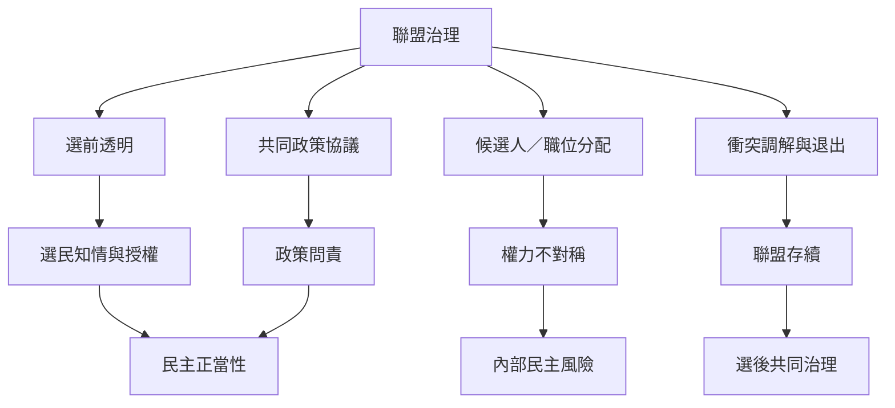

本圖把聯盟從勝選工具延伸到民主治理。聯盟需要處理政策承諾、權力分配、內部民主、選民知情、少數夥伴保障與退出程序。聯盟能擴大政治代表，也可能模糊責任、弱化黨內民主或造成權力不對稱。

主要連結：[[選前承諾的可信度取決於可監督與違約成本]]、[[選前聯盟不能自動保證選後共同治理]]、[[聯盟中的權力不對稱會削弱協調的實際效果]]、[[選舉協調的民主正當性取決於選民是否理解交換條件]]、[[南非聯盟治理框架主張把選前合作納入完整生命週期]]。

概念入口：[[Coalition agreement]]、[[Government coalition]]、[[Pre-electoral coalition]]。
