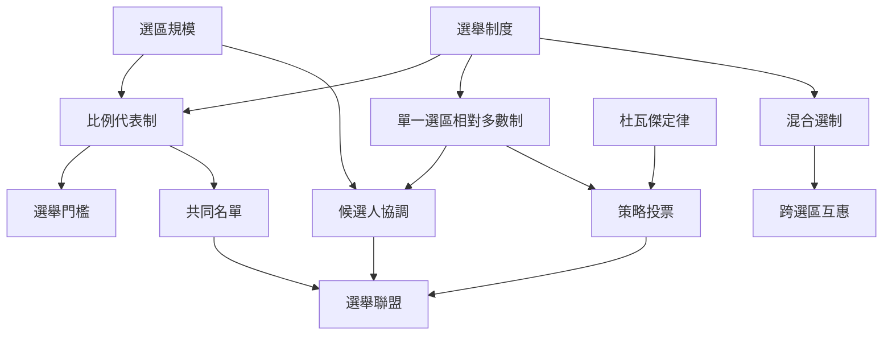

本圖將制度設計與選舉策略連結起來。選舉門檻、選區規模、比例性與混合選制改變政黨參選的風險；政黨可能以共同名單、候選人互退或策略投票回應。制度提供誘因，但不直接決定合作結果。

主要連結：[[選制誘因必須和政黨體系結構一起解釋]]、[[聯盟談判的核心之一是相對選票貢獻如何換算成提名權]]、[[候選人互退能把選舉合作變成可持續的互賴關係]]、[[候選人退選可以形成協調效果但不等於正式聯盟]]、[[法律可以重塑政黨結盟的策略空間]]。

概念入口：[[Electoral threshold]]、[[Proportional representation]]、[[Single non-transferable vote]]、[[Strategic voting]]、[[Duverger's law]]、[[Mixed electoral system]]、[[Candidate withdrawal]]。
