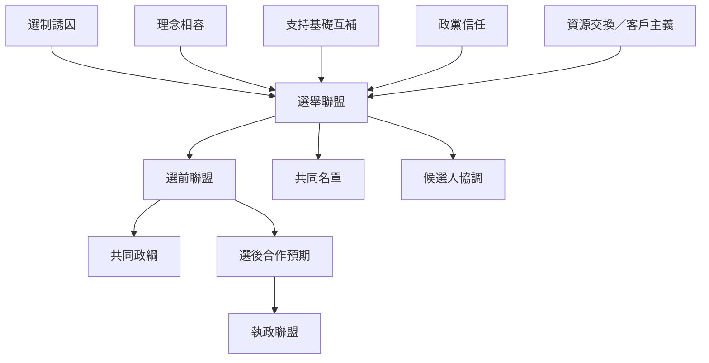

本概念地圖整理選舉聯盟的類型、動機與形成條件。核心問題不是「政黨是否合作」，而是合作發生在什麼時點、涵蓋哪些行動、如何交換資源，以及承諾是否可信。形成理論同時考慮理念相容、選制誘因、支持基礎互補、政黨規模、信任與客戶主義。

主要連結：[[選舉聯盟是選前協調而不是選後組閣的同義詞]]、[[選制誘因必須和政黨體系結構一起解釋]]、[[理念相容性與選舉互補性是兩種不同的聯盟資產]]、[[聯盟信任是理念相容性之外的獨立形成條件]]、[[選舉聯盟的動機會隨政黨組織與政治經濟環境而改變]]。

概念入口：[[Electoral alliance]]、[[Pre-electoral coalition]]、[[Government coalition]]、[[Coalition agreement]]、[[Party system]]、[[Clientelism]]。
