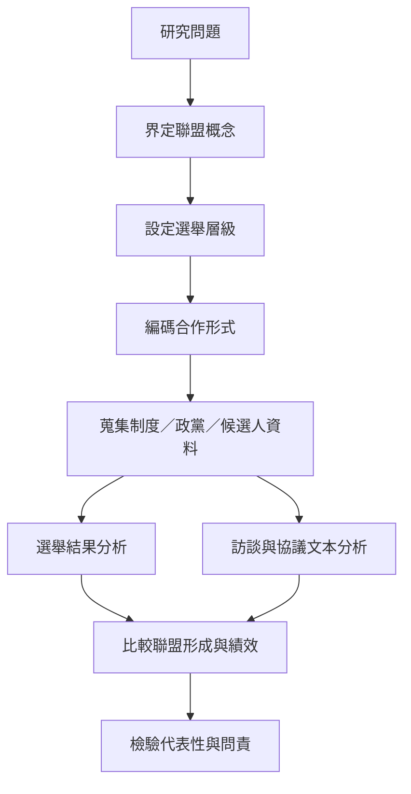

要跨國比較選舉聯盟，必須將概念操作化，並避免把不同時間、層級與正式程度的合作混為一談。研究資料可分為制度資料、政黨屬性、聯盟協議、候選人名單、選舉結果、訪談與選後政策履約。研究者需明示案例選取、編碼規則與缺漏資料，並以質性過程追蹤補足量化指標。

主要連結：[[建立選舉聯盟跨國比較資料集並區分正式度與時間點]]、[[選舉聯盟必須在正確的選舉層級上分析]]、[[台灣SNTV候選人協調是選舉聯盟研究的重要鄰接機制]]。

概念入口：[[Electoral alliance]]、[[Electoral coordination]]、[[Party system]]、[[Electoral geography]]。
