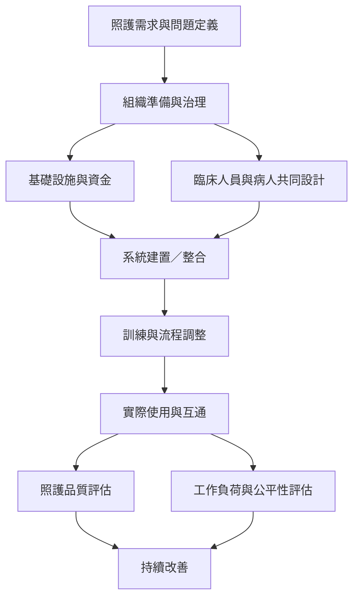

EHR 導入應以照護問題為起點，從組織準備、共同設計、資料標準與基礎設施，推進到訓練、使用、評估與持續治理。不同國家的資源條件與制度背景會改變最佳導入路徑。

延伸：[[電子健康紀錄]]、[[互通性]]、[[臨床文件]]、[[健康資料治理]]、[[數位健康]]。

## 參考
* [[低收入國家的電子健康紀錄導入受基礎設施與組織能力共同限制]]。
* [[電子病歷文件負擔需要一致的測量方法才能改善]]。
* [[全球數位健康策略必須整合治理、人力、財務與技術]]。
