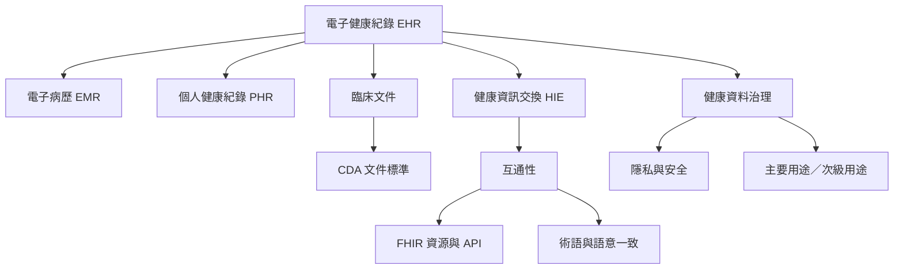

電子健康紀錄可視為由資料結構、交換標準、臨床流程與治理機制構成的社會技術系統。此圖呈現從單一機構紀錄走向跨機構互通所需的主要環節。

延伸：[[電子健康紀錄]]、[[電子病歷]]、[[個人健康紀錄]]、[[健康資訊交換]]、[[互通性]]、[[FHIR]]、[[臨床文件架構]]、[[數位健康]]、[[健康資料治理]]。

## 參考
* [[全球數位健康策略必須整合治理、人力、財務與技術]]。
* [[互通性必須同時處理技術標準與組織協作]]。
* [[台灣以跨院電子病歷交換建構醫療資訊連續性]]。
