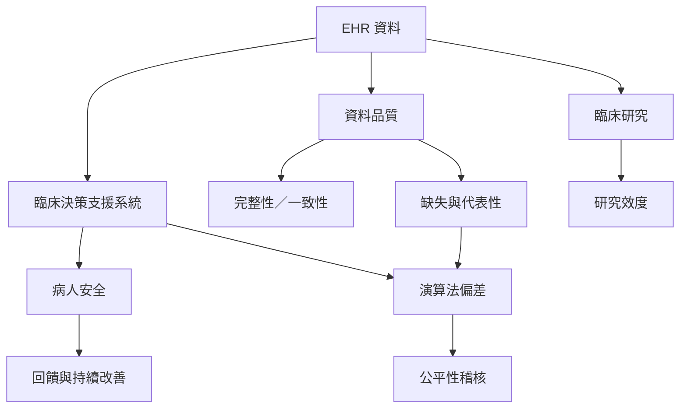

EHR 可以成為臨床研究與決策支援的資料基礎，但紀錄的生成方式、缺失機制與代理指標會影響推論公平性。安全評估需要同時考慮模型輸出與臨床工作流程。

延伸：[[臨床決策支援系統]]、[[演算法偏差]]、[[病人安全]]、[[臨床文件]]、[[電子健康紀錄]]。

## 參考
* [[臨床預測演算法可能把既有醫療不平等寫入電子紀錄資料]]。
* [[電子健康紀錄的研究價值取決於資料生成脈絡]]。
* [[電子健康紀錄的研究價值與演算法公平必須共同評估]]。
