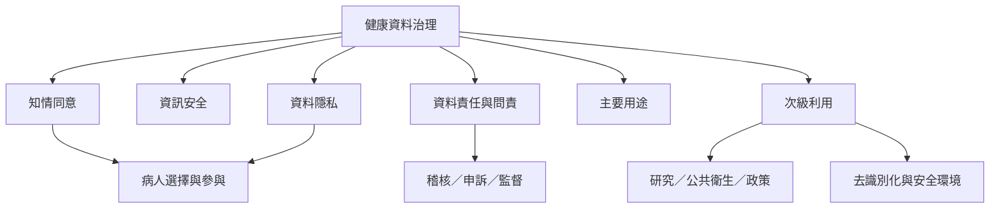

健康資料治理要平衡個人權利、臨床照護與公共利益。主要用途與次級用途應清楚分開，並由適當的同意、存取控制、資料最小化與監督機制支撐。

延伸：[[健康資料治理]]、[[資料隱私]]、[[知情同意]]、[[次級利用]]、[[資料去識別化]]。

## 參考
* [[歐盟健康資料空間將個人照護與研究再利用納入共同治理]]。
* [[病人與研究者對健康資料再利用的期待並不完全一致]]。
* [[澳洲 My Health Record 展示國家級個人健康紀錄的治理取捨]]。
