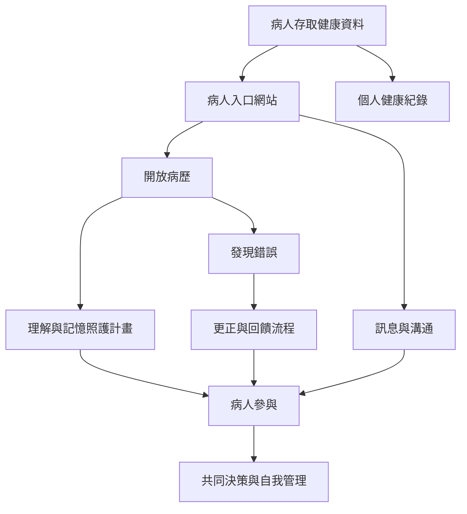

病人存取紀錄是把資訊透明轉化為照護參與的其中一種方式。若缺乏可理解語言、回覆與更正機制，單純開放資料仍可能讓病人承受資訊負擔。

延伸：[[個人健康紀錄]]、[[病人入口網站]]、[[開放病歷]]、[[病人參與]]、[[知情同意]]。

## 參考
* [[病人查閱電子健康紀錄與較高的醫療參與度呈正向關聯]]。
* [[OpenNotes 研究顯示病人查閱醫師紀錄可能促進信任與錯誤修正]]。
* [[紀錄透明需要安全的回饋與更正管道]]。
