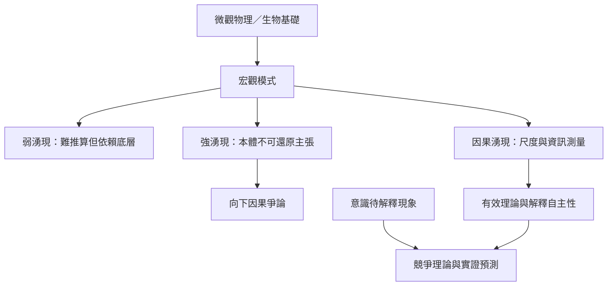

湧現的哲學爭論主要涉及弱／強湧現、向下因果、因果封閉與高層次解釋自主性。因果湧現研究則嘗試以模型和資訊測量比較不同尺度；意識研究進一步要求明確界定待解釋現象與可區分的實證預測。跨文化關係性思想可以提供比較視角，但不應被簡化成同一套科學理論。

概念連結：[[湧現]]、[[弱湧現]]、[[強湧現]]、[[向下因果]]、[[因果湧現]]、[[關係性人格]]。

相關永久筆記：[[高層次解釋具有自主性不等於違反底層物理]]、[[因果湧現是分析尺度改變後因果資訊結構的研究問題]]、[[意識的湧現假說必須區分現象描述與神經機制]]、[[關係性思想與湧現可以對話但不能視為同一理論]]。

相關靈感：[[把內觀經驗描述與神經科學解釋分成兩欄]]、[[建立一張跨尺度解釋比較表]]。

回到導讀：[[Emergence]]。
