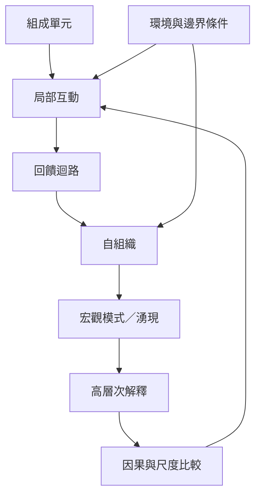

湧現研究的核心問題，是局部組成單元如何透過互動形成較高尺度的模式，以及研究者如何界定系統邊界、尺度與可檢驗機制。這張圖串起湧現、自組織、複雜適應系統、非線性與回饋，並連到觀察和知識設計的靈感。

概念連結：[[湧現]]、[[弱湧現]]、[[強湧現]]、[[自組織]]、[[複雜適應系統]]、[[非線性]]、[[回饋迴路]]、[[相變]]、[[圖樣形成]]。

相關永久筆記：[[湧現不是神秘創生而是跨尺度互動形成的可觀察模式]]、[[微觀規則可以生成宏觀規律但不能直接從個體直覺推知]]、[[自組織需要局部規則與環境條件共同作用]]、[[湧現研究需要把機制主張轉成可反駁的觀察]]。

相關靈感：[[把日常生活中的微觀互動記錄成一張湧現觀察卡]]、[[建立一張跨尺度解釋比較表]]、[[把知識庫設計成讓後續行動可讀取的公共痕跡]]。

回到導讀：[[Emergence]]。
