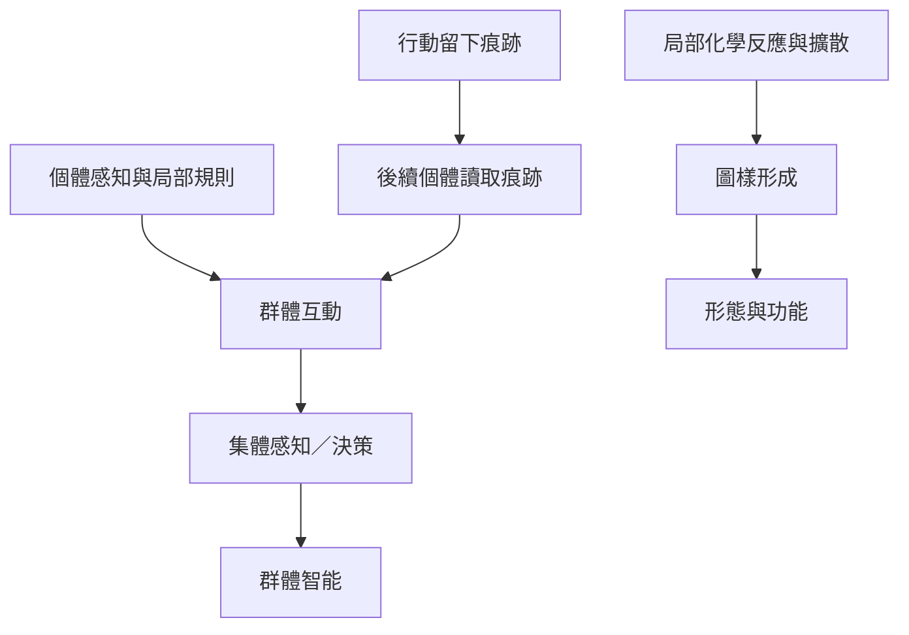

物質與生命中的湧現包含反應—擴散圖樣、動物群體協調與痕跡累積等現象。這些案例提醒我們，集體秩序並非必須由中央控制者逐一設計；但每一種模式都有其物質條件、互動規則與尺度限制。

概念連結：[[自組織]]、[[圖樣形成]]、[[相變]]、[[集體智能]]、[[痕跡協調]]、[[湧現]]。

相關永久筆記：[[自組織需要局部規則與環境條件共同作用]]、[[群體智能取決於資訊如何在成員間流動]]、[[痕跡協調讓行動成果成為下一輪行動的提示]]。

相關文獻：[[局部反應與擴散可以從均勻狀態生成生物圖樣]]、[[動物群體可透過局部互動形成集體感知與決策能力]]、[[行動留下的痕跡可以讓群體在沒有中央指揮下間接協調]]。

回到導讀：[[Emergence]]。
