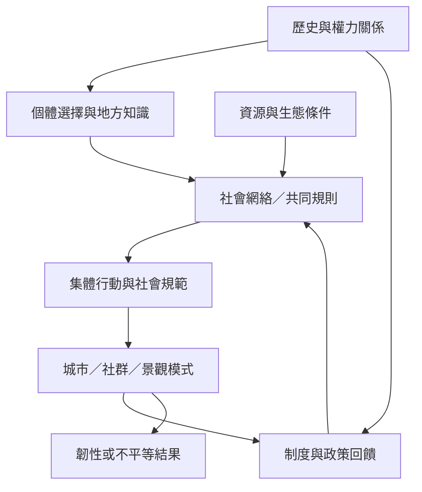

社會與生態系統中的湧現，不只是人群聚集的結果，也涉及歷史、資源、制度、空間與權力。城市尺度律、隔離模型、公地治理、里山景觀與地方知識提供不同尺度的案例；它們共同提醒：局部互動可能產生合作，也可能累積為排除或不平等。

概念連結：[[複雜適應系統]]、[[韌性]]、[[公地治理]]、[[多中心治理]]、[[社會規範動力學]]、[[關係性人格]]。

相關永久筆記：[[湧現模式可能放大偏見而不只產生合作]]、[[城市是由人際互動與基礎設施共同生成的複雜系統]]、[[韌性是吸收擾動與重新組織的能力而不只是恢復原狀]]、[[公地治理是有規則的集體自我組織而不是放任]]、[[地方與原住民族知識必須連同土地脈絡與權力關係一起理解]]。

相關靈感：[[把共食聚會設計成可觀察的自組織實驗]]、[[為每個社群實驗加入負面湧現的早期預警]]、[[以步行田野筆記描繪台中街區的湧現秩序]]、[[將共食桌視為一個可共同治理的小型公地]]。

回到導讀：[[Emergence]]。
