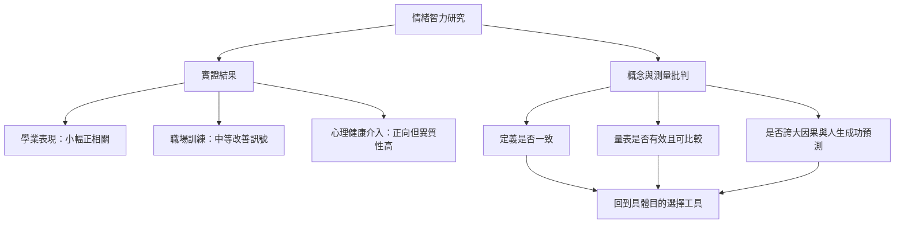

情緒智力的研究已累積與學業表現、職場訓練、心理健康及關係互動有關的證據，但效果大小與可靠程度因測量方式和研究設計而異。統合分析可以估計平均關聯或介入效果，卻不能自動證明因果；批判研究則提醒構念是否清楚、是否超越人格與一般智力，以及大眾宣稱是否過度。

## 雙向連結
* [[情緒智力的效益應以具體成果而非成功神話評估]]
* [[情緒智力的分數不能直接等同於人生成功]]
* [[情緒智力與學業表現呈現小幅正相關但不能推論因果]]
* [[職場情緒能力訓練呈現中等效果但研究品質仍有限]]
* [[成人情緒智力介入對心理健康呈現正向訊號但仍需嚴謹試驗]]
* [[情緒智力的分數必須先回答測量的是什麼]]
* [[情緒智力]]、[[情緒調節]]、[[情緒特質]]、[[人格特質]]。
