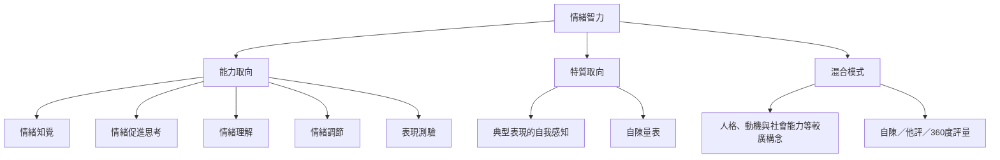

情緒智力研究的第一個關鍵，是分清理論模型與測量工具。能力模型將情緒處理拆成四個分支；特質模式測量典型自我感受；混合模式則納入較廣泛的社會與人格能力。這些模式可以互相對話，但不能未經驗證就把分數合併。

## 雙向連結
* [[情緒智力是一組處理情緒資訊的能力而不是單一性格優點]]
* [[情緒智力的分數必須先回答測量的是什麼]]
* [[情緒智力的三種主流模式測量的是不同層次的構念]]
* [[不同情緒智力量表可能測到彼此差異很大的心理特質]]
* [[能力模型將情緒智力拆成四種彼此關聯的心理能力]]
* [[情緒智力]]、[[情緒知覺]]、[[情緒促進思考]]、[[情緒理解]]、[[情緒調節]]、[[情緒特質]]、[[人格特質]]。
