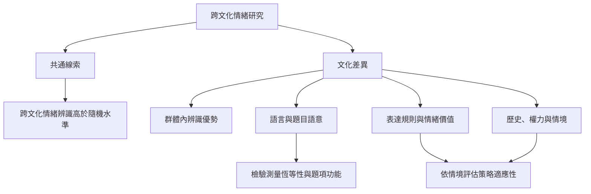

跨文化情緒智力研究需要同時看見共同的人類情緒線索與文化差異。情緒辨識可能高於隨機水準，但存在群體內優勢；情緒調節策略的心理健康關聯會隨文化價值與情境改變；量表翻譯也可能改變受測者對題目的理解。因此，文化不只是研究背景，也會影響概念界定、工具設計與結果解釋。

## 雙向連結
* [[情緒識讀應同時尊重跨文化共通與文化差異]]
* [[情緒辨識同時具有跨文化共通性與群體內優勢]]
* [[東亞與西方的情緒調節策略不能用同一套適應標準評價]]
* [[南非佩迪語量表研究顯示翻譯會改變情緒題目的意義]]
* [[奈及利亞本土量表研究指出情緒能力測量需要文化敏感度]]
* [[拉丁美洲多國研究示範如何檢驗情緒能力量表的跨文化效度]]
* [[泰國南部衝突地區青少年量表顯示情緒能力需要納入衝突脈絡]]
* [[文化心理學]]、[[情緒表達規則]]、[[情緒智力]]。
