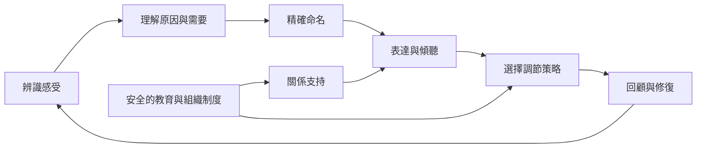

情緒能力的培養不應只靠個人意志或單次課程。個人可以練習覺察、命名、理解與調節；關係可以提供聆聽、確認與修復；教育和組織則需要建立安全、允許差異並改善造成情緒耗損的制度。可行的培養循環是：先辨識情緒，再理解脈絡，選擇表達與調節方式，最後回顧行動結果。

## 雙向連結
* [[情緒教育應讓辨識命名理解表達與調節成為可練習的循環]]
* [[情緒能力是在關係互動中共同建構而非只屬於個人]]
* [[同理心需要結合界線與非暴力溝通才能轉化為互相理解]]
* [[職場情緒能力訓練呈現中等效果但研究品質仍有限]]
* [[成人情緒智力介入對心理健康呈現正向訊號但仍需嚴謹試驗]]
* [[情緒能力不能取代公平制度與良好工作條件]]
* [[社會情緒學習]]、[[非暴力溝通]]、[[同理心]]、[[心理安全感]]。
