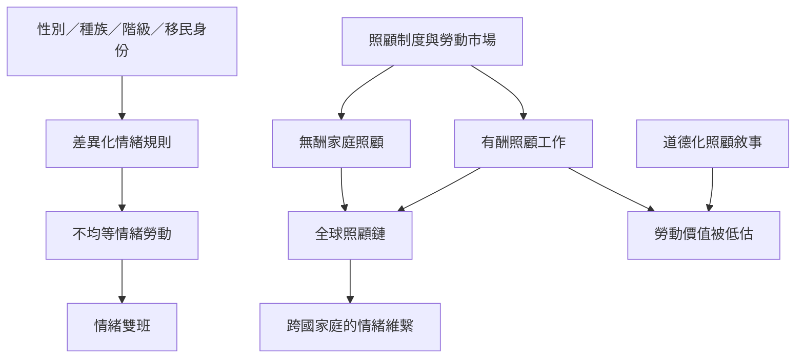

這張地圖將情緒勞動放回性別、種族、階級、移民制度與照顧體系。情緒規則並非人人平等承受；某些群體需要額外管理自己的表達，也需要修復他人造成的互動傷害。照顧工作的道德化與全球轉移，則讓有酬與無酬情緒工作跨越家庭、職場與國界。

## 思與行
* 先讀 [[工作場所的情緒規則可能被種族化]] 與 [[情緒雙班揭示交織不平等如何增加隱形工作]]，理解不平等如何進入日常互動。
* 再讀 [[照顧工作中的情緒勞動容易被道德化並低估報酬]]、[[全球照顧鏈把照顧需求跨國轉移]]，將個人經驗連回制度與跨國分工。

## 參考
* 永久筆記：[[有酬家務與無酬家務構成連續的性別化勞動]]、[[跨文化比較不能把西方情緒規範當成普遍標準]]。
* 文獻：[[種族、性別與病床邊的情緒實踐｜Cottingham 等 2018]]、[[台灣菲律賓移工的家務勞動連續性｜Lan 2003]]、[[《Servants of Globalization》｜Parreñas 2001]]、[[全球健康與照顧工作的性別不平等｜WHO 2024]]。
* 概念：[[交織性]]、[[照顧工作]]、[[全球照顧鏈]]、[[道德勞動]]。
