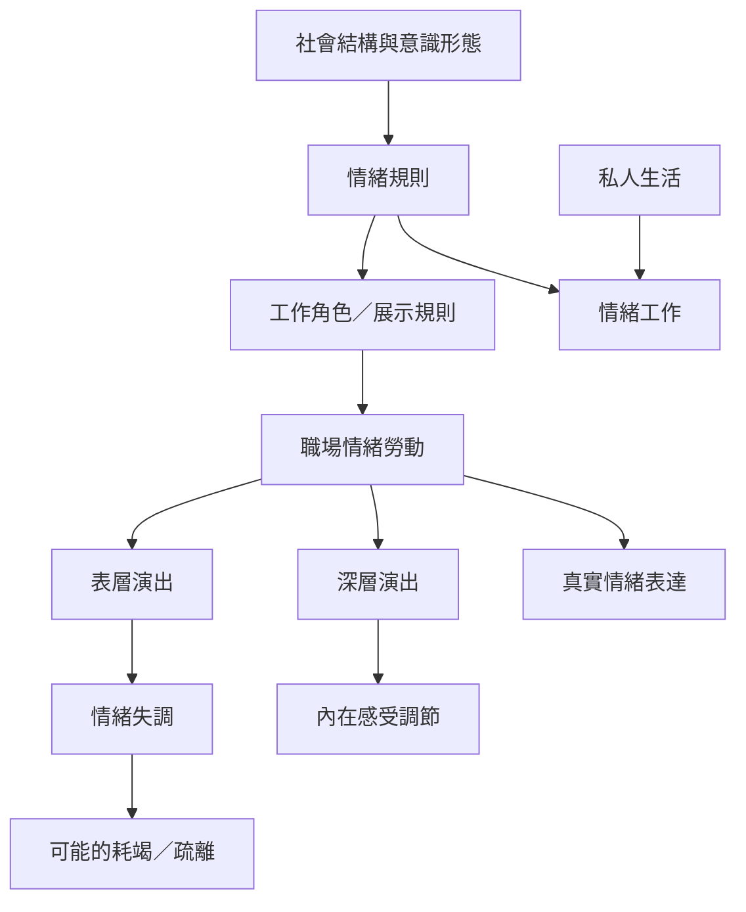

本概念地圖從 Hochschild 的情緒管理視角出發，整理情緒規則、情緒工作、情緒勞動，以及表層／深層演出的關係。閱讀時先辨認概念的分析場域：私人生活中的情緒工作，與有薪且受組織規範的職場情緒勞動彼此相關，但不是完全相同。

## 思與行
* 先讀 [[情緒工作、情緒規則與社會結構｜Hochschild 1979]]，再讀 [[《The Managed Heart》｜Hochschild 1983]]。
* 接著比較 [[職場情緒調節模型｜Grandey 2000]] 與 [[情緒勞動作為情緒調節的再檢視｜Grandey 與 Melloy 2017]]，理解社會學與心理學分析焦點的差異。

## 參考
* 永久筆記：[[情緒勞動是組織對工作者情緒表達的制度性要求]]、[[私人生活中的情緒工作不等於嚴格意義的職場情緒勞動]]、[[情緒規則會分配不同群體的感受義務]]、[[表層演出改變外在表情卻未必改變內在感受]]、[[深層演出試圖調整感受以符合角色期待]]、[[情緒失調來自真實感受與角色要求的落差]]。
* 概念：[[情緒勞動]]、[[情緒工作]]、[[情緒規則]]、[[表層演出]]、[[深層演出]]、[[情緒失調]]、[[展示規則]]。
