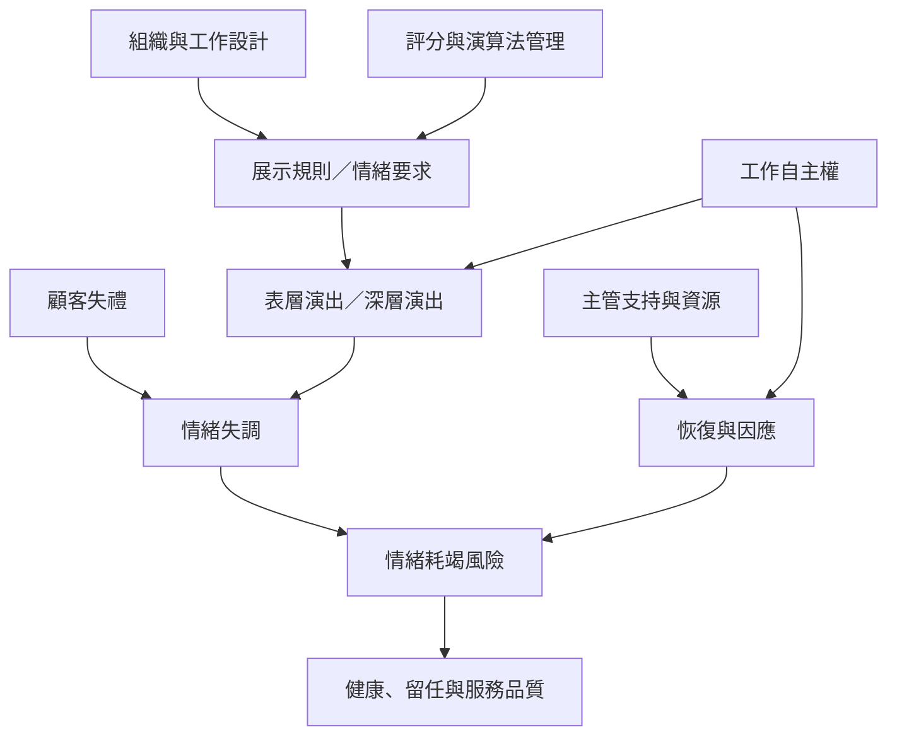

這張地圖聚焦情緒勞動如何被工作設計、顧客互動、績效監控與組織資源形塑，以及它可能帶來的福祉與服務後果。核心問題不是工作者有沒有情緒，而是組織如何規定、監督與補償情緒表達。

## 思與行
* 使用 [[情緒勞動的測量必須拆解成不同面向]] 檢查研究構面，再以 [[情緒勞動的心理代價取決於策略與工作情境]] 解讀結果。
* 在組織改造上優先檢查 [[工作自主權能緩衝情緒勞動的健康風險]] 與 [[顧客失禮會把情緒管理成本轉嫁給第一線工作者]]。

## 參考
* 永久筆記：[[服務工作把情緒表達轉化為可管理的商品]]、[[情緒勞動的測量必須拆解成不同面向]]、[[情緒勞動的心理代價取決於策略與工作情境]]、[[工作自主權能緩衝情緒勞動的健康風險]]、[[顧客失禮會把情緒管理成本轉嫁給第一線工作者]]、[[情緒耗竭是長期情緒需求累積的結果之一]]、[[數位評分把情緒規則延伸成持續監控]]。
* 概念：[[情緒調節]]、[[情緒耗竭]]、[[顧客失禮]]、[[工作自主權]]、[[演算法管理]]。
