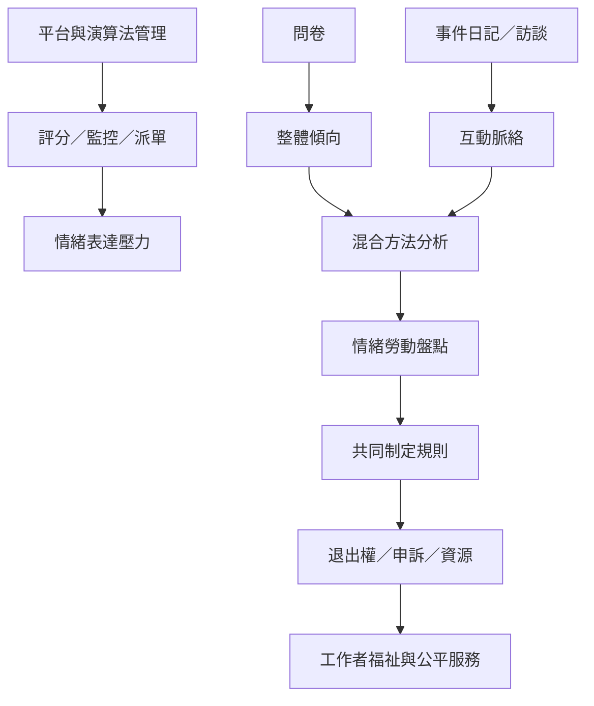

本地圖連結新型工作控制、研究方法與行動介入。演算法評分將顧客互動轉為資料，影響工作機會與處分；若只依靠一般問卷，也可能忽略情緒事件的脈絡。可行的改革必須將工作者納入規則制定、提供實際退出權，並讓情緒工作可見、可協商與有資源。

## 思與行
* 研究平台服務時，結合 [[用情緒事件日記補足問卷看不見的互動細節]] 與 [[平台經濟中的演算法管理與情緒勞動｜Wiley 2024]]。
* 將研究轉為組織實踐：[[建立情緒勞動盤點表讓隱形工作可被看見]]、[[把顧客友善標準改造成有界線的互惠服務規範]]、[[把工作者自主權設計成可以實際使用的退出權]]。

## 參考
* 永久筆記：[[數位評分把情緒規則延伸成持續監控]]、[[跨文化比較不能把西方情緒規範當成普遍標準]]。
* 行動筆記：[[重新設計績效指標避免只獎勵可見的微笑]]、[[培訓不該把制度缺口包裝成個人韌性不足]]、[[建立一套以工作者為中心的情緒勞動治理原則]]。
* 概念：[[演算法管理]]、[[工作自主權]]、[[情緒勞動]]。
