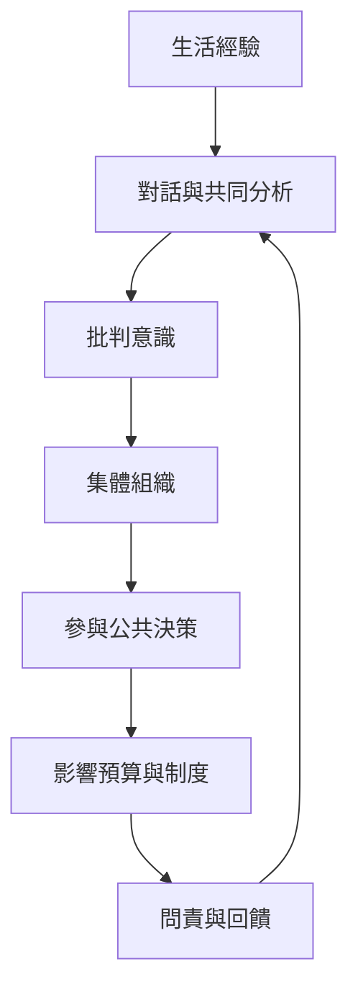

賦權的實踐路徑從經驗敘說與批判反思開始，經由對話、組織與集體行動，進入公共決策、資源配置與制度問責。真正的參與需要可見的決策影響，不只是表達意見。

概念連結：[[批判意識 Critical_Consciousness]]、[[參與 Participation]]、[[集體行動 Collective_Action]]、[[社區發展 Community_Development]]、[[參與式治理 Participatory_Governance]]、[[問責 Accountability]]、[[社區賦權 Community_Empowerment]]。

閱讀卡片：[[Freire 的對話教育把批判意識連結到反思與行動]]、[[集體組織能把個人聲音轉成可談判的公共力量]]、[[沒有制度回應的參與容易淪為象徵]]、[[社區賦權需要讓居民真正掌握部分公共資源]]。
