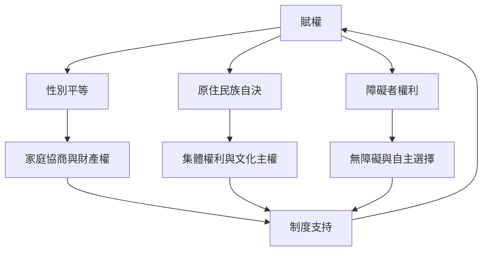

賦權必須回應具體的歷史與權力差異。女性、原住民族及身心障礙者面對的障礙不相同，但都提醒我們：形式平等或個人培力不足以取代資源控制、集體權利、可及性與共同決策。

概念連結：[[女性主義經濟學 Feminist_Economics]]、[[自決 Self_Determination]]、[[身心障礙者權利 Disability_Rights]]、[[無障礙 Accessibility]]、[[家庭協商 Household_Bargaining]]、[[社會正義 Social_Justice]]。

閱讀卡片：[[Agarwal 指出家庭內外的協商權力共同塑造性別關係]]、[[原住民族自決要求共同決策而非諮詢而已]]、[[障礙者賦權必須改變環境障礙與決策制度]]、[[女性經濟方案不能以金融參與直接代替性別平等]]。
