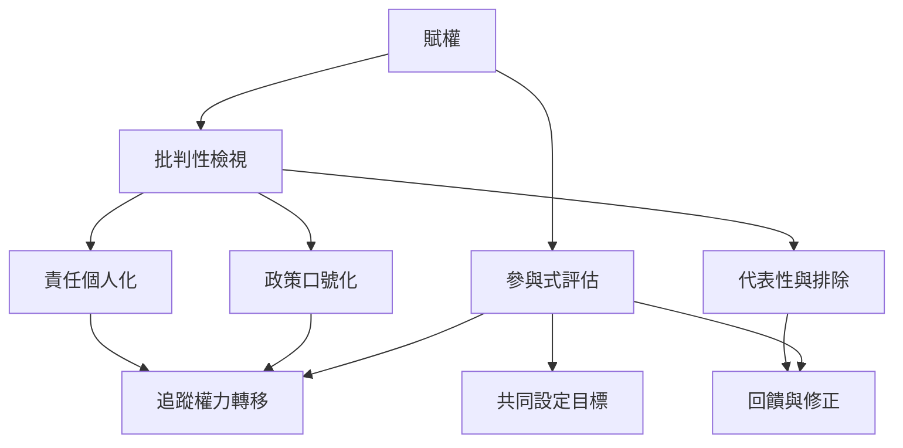

賦權可能在實務中被縮減為個人技能、心理狀態或可量化績效。這張地圖將賦權的批判面向與評估方法連結：追問誰定義成功、誰控制資源、誰承擔風險，以及受影響者是否能改變方案。

概念連結：[[問責 Accountability]]、[[參與式評估 Participatory_Evaluation]]、[[社會影響評估 Social_Impact_Assessment]]、[[權力 Power]]、[[社會正義 Social_Justice]]。

閱讀卡片：[[Cornwall 與 Brock 指出賦權可能被政策語言去政治化]]、[[賦權評估應追蹤過程和權力轉移]]、[[以參與式評估讓受影響者定義成功]]、[[用賦權檢核表評估一個社群計畫]]。
