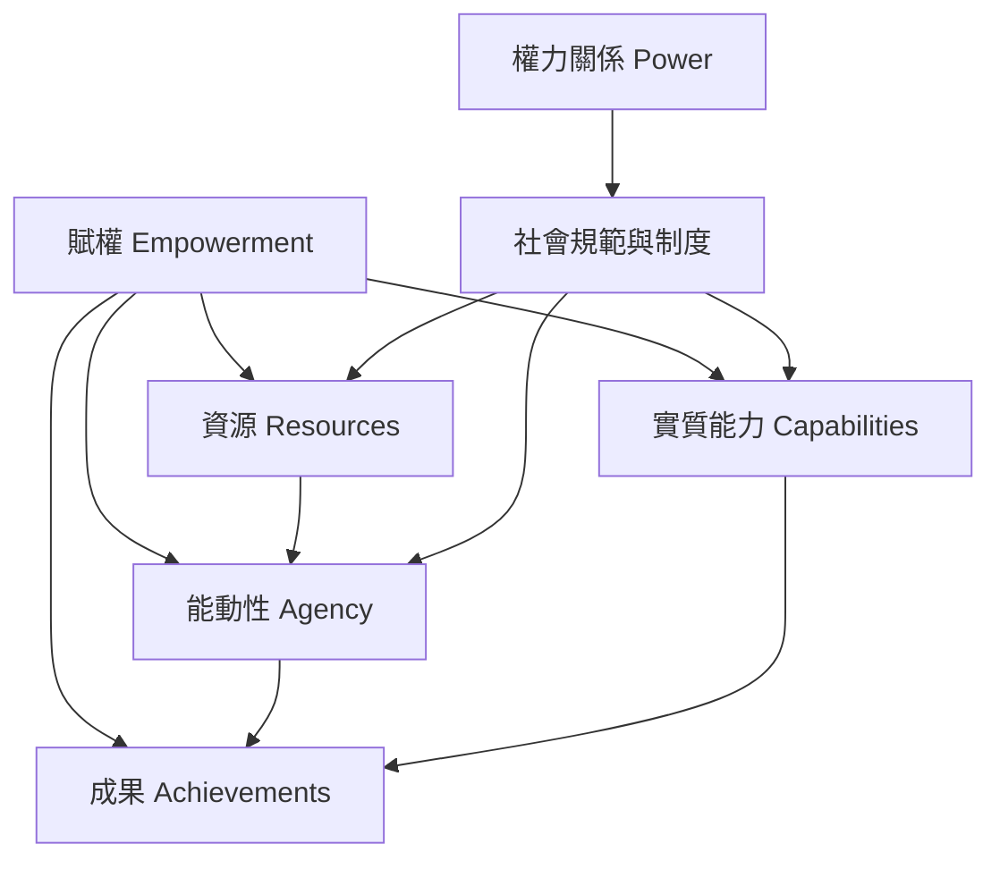

這張概念地圖整理賦權的核心構成：資源提供行動條件，能動性支撐選擇與協商，能力取徑檢查選擇是否真正可行，成果則呈現生活是否改變。權力關係與制度障礙會影響每個環節。

概念連結：[[賦權 Empowerment]]、[[能動性 Agency]]、[[權力 Power]]、[[能力取徑 Capability_Approach]]、[[自主 Autonomy]]、[[自我效能 Self_Efficacy]]。

閱讀卡片：[[女性賦權必須同時檢視資源能動性與成果]]、[[能力取徑要求關注人們實際能做與成為什麼]]、[[賦權同時涉及資源能動性與成果]]、[[賦權是重新分配決策權而非單純增強自信]]。
