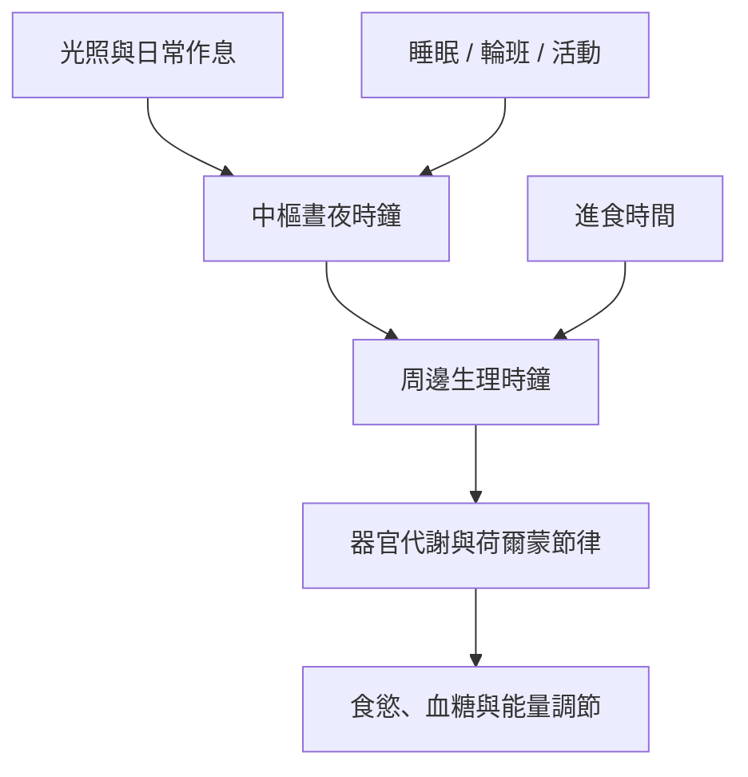

代謝不是全天候均速運轉。光照、睡眠、進食及活動時間會影響中樞與周邊生理時鐘的同步。時間線索與能量恆定相互作用，但進食時窗並非脫離生活情境的萬用方案。

### 核心筆記
* [[晝夜節律為能量恆定加上時間維度]]
* [[進食時間與生理時鐘共同影響代謝]]
* [[睡眠限制可能增加飢餓與攝食但荷爾蒙結果並不一致]]

### 概念連結
* [[晝夜節律]]、[[周邊生理時鐘]]、[[睡眠]]、[[能量恆定]]、[[能量攝取]]。
